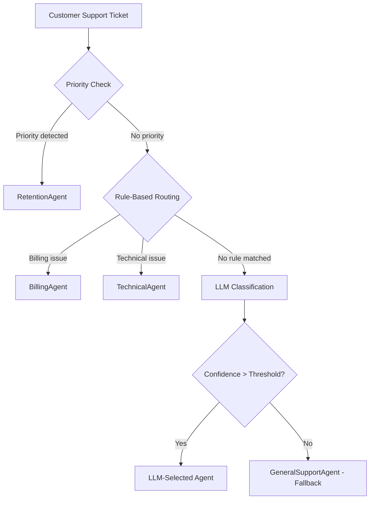
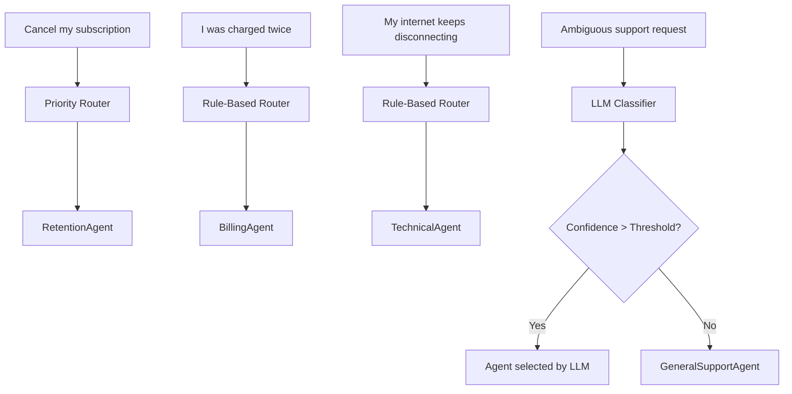

# Telecom Multi-Agent Customer Support Router

## Overview

A Python-based multi-agent system that routes telecom customer support tickets using a hybrid routing architecture. It combines priority detection, rule-based routing, LLM classification, and fallback handling to reduce unnecessary LLM calls, latency, and cost.

## Agents

| Agent | Responsibility |
|---|---|
| `RetentionAgent` | Handles priority cancellation, termination, and provider-switching requests. |
| `BillingAgent` | Handles billing inquiries and payment disputes. |
| `TechnicalAgent` | Handles technical issues and service disruptions. |
| `GeneralSupportAgent` | Handles general inquiries and low-confidence requests. |

## Hybrid Routing Flow



## Sample Routing Flow



## Routing Decision Output

The `hybrid_route()` function returns:

- `target_agent`: Selected destination agent.
- `method`: `priority`, `rule`, `llm`, or `fallback`.
- `confidence`: Routing confidence score.
- `latency_ms`: Total routing latency in milliseconds.
- `reason`: Explanation for the routing decision.

## Technology Stack

- Python
- Strands Agents
- Amazon Bedrock
- Amazon DynamoDB
- AWS CloudFormation

## Project Structure

```text
Telecom/
├── telecom_router.py
├── infrastructure/
│   └── stack.yaml
├── requirements.txt
└── README.md
```

## Setup and Run

### 1. Activate the virtual environment

**Windows PowerShell:**

```powershell
.\venv\Scripts\Activate.ps1
```

### 2. Install dependencies

```bash
pip install -r requirements.txt
```

### 3. Validate the CloudFormation template

```bash
aws cloudformation validate-template \
  --template-body file://infrastructure/stack.yaml \
  --region us-east-1
```

### 4. Deploy AWS infrastructure

```bash
aws cloudformation deploy \
  --template-file infrastructure/stack.yaml \
  --stack-name Telecom-routing-audit \
  --region us-east-1
```

### 5. Run the router

```bash
python telecom_router.py
```

Ensure AWS credentials, Bedrock model access, and DynamoDB configuration are set correctly.

## Key Benefits

- Prioritizes cancellation-related requests.
- Routes predictable tickets without unnecessary LLM calls.
- Uses LLM classification for ambiguous requests.
- Provides fallback handling for low-confidence classifications.
- Measures routing latency and supports routing audit logs.
